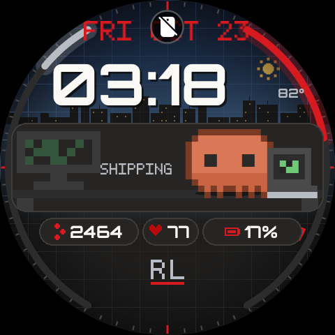
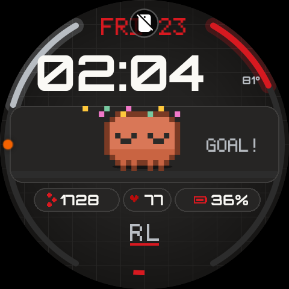
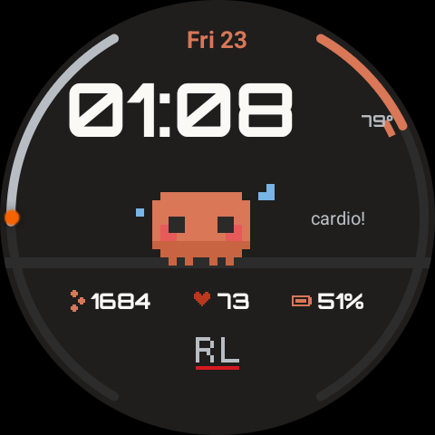
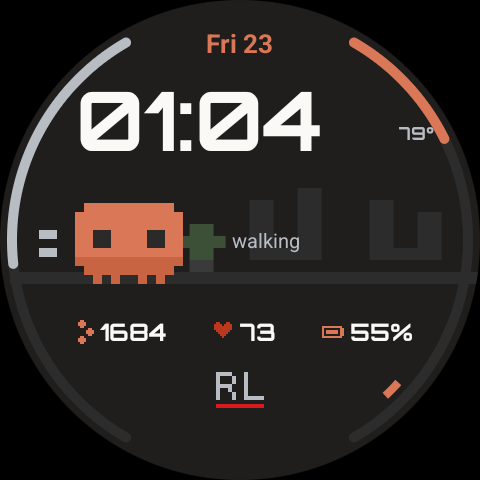
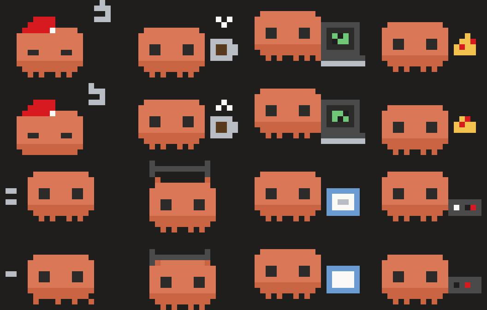
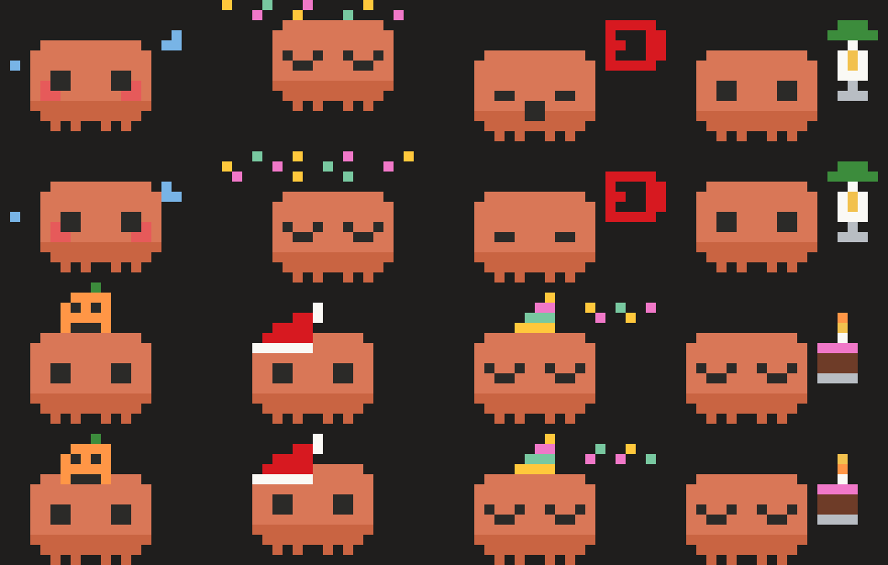
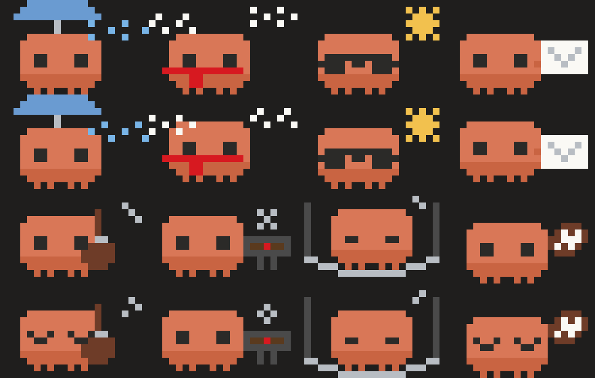

# Clawd Watch Face

<p align="center">
  
</p>

<p align="center">
  
  
  
</p>

<p align="center"><sub>Live screenshots from a Galaxy Watch7. Left to right: step goal hit, cardio mood, afternoon walk.</sub></p>

A hand-built [Watch Face Format](https://developer.android.com/training/wearables/wff) face for the
Samsung Galaxy Watch7 (Wear OS 5 / 6) starring **Clawd**, the Claude Code mascot, drawn as pixel art in
the Claude palette with a Redline Tech Solutions mark. Clawd lives on the face: he follows a daily
schedule, reacts to your health data, notices the weather, and does something different every hour.

Everything here was designed, drawn, generated, built, installed and debugged in a single session with
Claude Code, over ADB wireless debugging, without opening Android Studio or Watch Face Studio.

**Found a bug, tried it on another watch, or built a variant?** [Open an issue](https://github.com/JeffClouse77/clawd-watch-face/issues).

### Meet the cast

Every frame is drawn by Python on a pixel grid. Weekday states, then moods and calendar surprises, then weather, mail and weekend:

<p align="center">
  
  
  
</p>


## What the face does

**Clawd's day.** Nine weekday states (sleeping, coffee, coding, lunch, walking, shipping, gym, reading,
gaming) and a separate weekend schedule (sleeping in, coffee, guitar, grilling, the game, hammock,
reading). He moves between the left, centre and right of his window, each state has its own pixel
backdrop, and every idle loop blinks.

**Moods from your data.** Heart rate over 120 and he sweats; hit your Samsung Health step goal and he
jumps in confetti; battery under 15 % and he yawns under a red icon; on the charger he's plugged in.

**He notices things.** Unread notifications put an envelope in his hand with the count. Rain gives him an
umbrella, snow a scarf, 90 °F a pair of sunglasses, with matching full-screen rain, snow or starfield
effects behind the clock. A dark sky by night, warm dawn, blue day and burnt dusk, with a sun that rises
left at 06:00 and sets right at 18:00 and a real-phase moon that takes the same arc overnight.

**Calendar surprises.** Friday after 17:00 (drink with an umbrella), Oct 31 (pumpkin), Dec 25 (Santa
hat), Jan 1 (party hat), and an optional birthday (cake with a flickering candle).

**Interaction.** Tap Clawd and he waves, offers you his pizza at lunch, or does a "ship it" fist pump
while coding. At the top of every hour he does a backflip. Tapping the step count opens Samsung Health,
the heart starts a heart-rate measurement, the battery opens battery status, the temperature opens the
weather app.

**Instrument details.** Steps and battery as bezel ring gauges with a soft glow, a single accent pixel
orbiting once a minute as the seconds hand, a 60-tick minute ring, Orbitron numerals with a drop shadow,
a 5x7 pixel typeface for captions and the date, heart rate coloured by zone, the backdrop sliding with
wrist tilt, and a burn-in-safe ambient mode (outline-only Clawd, everything else off).

**Customize menu.** *Accent* (Claude orange, Redline red, Air Force blue) recolours the gauges, date,
icons and seconds pixel. *Showcase* forces any of 15 states so you can demo rain, snow, the birthday cake
or the charging animation without waiting for them.

## How it is built

There is no Java or Kotlin. A Watch Face Format package is an APK containing only XML and images, so the
whole thing is Python scripts that draw the assets and generate the XML, plus a PowerShell build script.

| Script | Produces |
|---|---|
| `tools/make_sprites.py` | Every Clawd state as an animated WebP (grid-based pixel art, outline, shadow, blink frame), the tap reactions, moon phases, icons |
| `tools/make_scenes.py` | The backdrops inside Clawd's rounded window, three of them animated |
| `tools/make_sky.py` | Daypart sky gradients, the sun, the skyline, the vignette overlay, rain / snow / star effects |
| `tools/make_font.py` | The 5x7 pixel typeface as one PNG per glyph plus the `<BitmapFonts>` block |
| `tools/gen_watchface.py` | `res/raw/watchface.xml` (about 120 KB, 90 condition branches) from the schedule and priority tables |
| `tools/make_wallpaper.py` | Matching phone wallpaper and lock screen |
| `build.ps1` | `aapt2 compile` → `aapt2 link` → `zipalign` → `apksigner` → `adb install` |

Priority when several things are true: health moods > unread mail > weather > calendar surprise >
weekday or weekend schedule.

### Building it yourself

Needs Python 3 with Pillow and fontTools, a JDK, Android SDK build-tools 35 and platform 34, and
`adb` (all installable with `winget`). Edit the paths at the top of `build.ps1`, then:

```powershell
python tools\make_font.py
python tools\make_sprites.py
python tools\make_scenes.py
python tools\make_sky.py
python tools\gen_watchface.py
.\build.ps1 -Install -Device <watch-ip>:<port>
```

The first run creates a debug keystore (set `CLAWD_KS_PASS` to choose its password). On the watch,
enable Developer options, turn on Wireless debugging, pair once with `adb pair`, then connect.

The font is [Orbitron](https://github.com/google/fonts/tree/main/ofl/orbitron) (SIL Open Font License),
instanced to a static Bold with fontTools.

## Things we learned the hard way

These cost real time and are not well documented. If you build a Watch Face Format face for a Galaxy
Watch, start here.

- **Animated GIFs do not animate on the Samsung runtime.** They render their first frame and stop.
  Animated WebP plays. Loop with `repeat="TRUE"`, not `loop`.
- **Weather data takes a minute to arrive.** `[WEATHER.IS_AVAILABLE]` is false right after install even
  when the watch's own Weather app is full of data. Wait, don't debug.
- **Don't use the `DEBUG_SURFACE set-watchface` broadcast for updates.** It creates a second "favorite"
  instance of your face. The Customize editor then saves to the carousel's copy while the screen shows
  the broadcast's copy, so settings appear not to stick. Use it once for the first install, then plain
  `adb install -r`.
- **`<Editable value="true"/>` in `watch_face_info.xml`** or One UI never shows a Customize button.
- **A `ListConfiguration` whose options hold whole subtrees must be a direct child of `Scene`**, as
  in Google's Flavors sample. Nested inside a `Group` the editor previews it but the choice is unreliable.
- **Samsung's charging overlay covers every watch face**, so a "charging" state is only visible through
  a Showcase setting or in the moment after the charger comes off.
- **The always-on clock you see after the screen dims is Samsung's offloaded system clock**, not the
  face's ambient layout, which only shows in the first dimming stage.
- **`exec-out screencap` through PowerShell 5.1 corrupts the PNG.** `screencap -p /sdcard/x.png` then
  `adb pull`. Under Git Bash set `MSYS_NO_PATHCONV=1` or `/sdcard/...` gets rewritten.
- **Wireless debugging picks a random port and drops when the watch dozes.** A batched TCP sweep of
  30000–49999 finds it again in a couple of seconds. The watch also turns Wi-Fi off whenever it is
  Bluetooth-connected to the phone unless Wi-Fi is set to *Always on*. The face itself never needs
  Wi-Fi: health, weather and notifications all arrive over Bluetooth.
- **Expressions can do trigonometry.** `sin`, `cos` and `rad` work in `Transform` values, which is how
  the sun and moon travel. `clamp`, ternaries and `%` formatting all work too.
- **Pixel fonts are wide.** A bitmap font at the same nominal size takes about 40 % more width than the
  system font; size caption boxes to the panel, not to the text you first tried.
- **Driving the One UI face carousel over `adb shell input` is risky.** Long-pressing it a second time
  enters remove mode with a delete button on every face. Let a human do the editor.

## Session log

Built on 2026-10-23 in one Claude Code session, in this order:

1. Discovered the watch on the LAN, installed Android platform tools, paired over Wireless debugging.
2. Drew Clawd, built the first face (time, date, steps, heart rate, battery, eight dayparts), fixed the
   GIF-doesn't-play problem by moving to WebP.
3. Added moods, tap reactions, ring gauges, calendar surprises, a birthday.
4. Scene backdrops, hour-tinted clock, blinking, ambient mode, Orbitron.
5. Weather, unread mail, weekend schedule, tap-to-launch shortcuts (format version 2).
6. Theme picker, hourly flip, orbiting seconds pixel, moon phase, step goal from the watch, phone
   wallpapers.
7. Showcase setting, charging state, heart-rate zones, tilt parallax; debugged why Customize choices
   didn't stick.
8. Pixel typeface, vignette, Clawd's window, outline and shadow; then ring glow, data pills, living
   scenes, ambient rework.
9. Clawd's World: daypart skies, travelling sun and moon, skyline, tick ring, full-screen effects.

## Credits

Clawd is Anthropic's Claude Code mascot; this is a fan-made face, not an Anthropic product.
Orbitron by Matt McInerney, SIL OFL 1.1. Everything else drawn in Python with Pillow.

## License

The code and build scripts are [MIT licensed](LICENSE). The Clawd character belongs to Anthropic and is
not covered by that license. Orbitron keeps its own SIL Open Font License.
